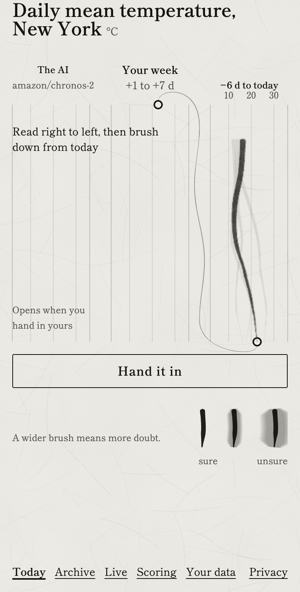

# Forecastle

Draw the next week and try to beat the machine.

Forecastle gives you a real chart with the ending hidden. Draw your guess, then reveal what happened and see whether you got closer than the AI.



**[Play today's puzzle](https://forecastle.intesarjawad.com/)**. Free in your browser, with a new puzzle each day.

## Make your own puzzle

Turn any daily series into a puzzle against the same model. It runs on your machine, and your data leaves it only inside the link you choose to send.

```sh
uvx --torch-backend cpu --from git+https://github.com/intesarjawad/forecastle forecastle-pipeline custom my.csv
```

No CSV? Use the daily views of any English Wikipedia article:

```sh
uvx --torch-backend cpu --from git+https://github.com/intesarjawad/forecastle forecastle-pipeline custom --wikipedia Pumpkin
```

The CSV needs a header row and at least 35 daily rows. You see the first 28 and draw the last 7, which the model has not seen. The first run downloads the model once, then each run prints a link and opens the puzzle in your browser.
<!-- number: 35 rows, pipeline/forecastle_pipeline/io/custom_csv.py REQUIRED_ROWS; 28 and 7, cli.py CUSTOM_VISIBLE_DAYS and CUSTOM_HORIZON_DAYS -->

The link carries the whole puzzle in its `#` fragment, which browsers never send to a server. It is not encrypted: anyone holding the link can read the data, so send it only where you would send the CSV.

No uv? `brew install uv`, or see [uv's install page](https://docs.astral.sh/uv/getting-started/installation/).

## How it works

A real daily series, such as the temperature in a city or the views of a Wikipedia article, stops at today. You draw the next seven days and set how sure you are with a band around your line. Then you see what really happened, and what [amazon/chronos-2](https://huggingface.co/amazon/chronos-2), an open forecasting model, predicted from the same 28 points.
<!-- number: 28 visible and 7 scored days, pipeline/forecastle_pipeline/core/puzzle.py WindowShape -->

## Scoring

**Closeness** is how far off you were, measured in typical daily moves of that series. 100 is exact, and a flat line scores a median of 50.
<!-- number: flat-line median Closeness 50, scripts/calibrate_k.py --run-date 2026-11-05, recorded in docs/adr/0001-scoring-and-calibration.md -->

**Your band** counts how many of the seven real days it caught. A well calibrated band catches about 8 in 10 over time. It is not part of Closeness; it tracks your calibration.
<!-- number: 80% band, the AI band is its 10th to 90th percentile, site/src/ui/messages.ts how.coverage -->

The formula and the reasons for not using CRPS are in [ADR 0001](docs/adr/0001-scoring-and-calibration.md).

## Your data

No account, no cookies, no analytics. When you hand in a daily puzzle, your play is sent so the crowd line can be drawn: seven values, the band width, the time to lock, and an id that changes with every puzzle, so two of your plays cannot be linked. The server stores no IP address. Sharing sends nothing.

Turn the crowd line off, download your history or move it to another phone at [#/data](https://forecastle.intesarjawad.com/#/data). Every field is listed in [docs/privacy.md](docs/privacy.md).

## Humans vs the model

Daily puzzles are practice. Their answers are public files in this repo, so they run on the honour system and never count.

Live rounds are the real test, planned for Mondays and Thursdays. Each has three charts whose scored days have not happened yet. When a round opens, the model's forecast is published only as a SHA-256 hash with an OpenTimestamps proof, and revealed when entries close, so nobody can copy it. You draw each chart and lock it before the cutoff. No round has run yet:

<!-- benchmark:start -->
No paired rounds scored yet (n = 0 charts in 0 rounds; Monday-only n = 0 charts in 0 rounds).
<!-- benchmark:end -->

`uv run python scripts/benchmark_report.py` rebuilds that table. Methods and limits are in [BENCHMARK.md](BENCHMARK.md). The analysis plan in [ADR 0008](docs/adr/0008-live-round-analysis.md) is a draft, to be frozen and timestamped before the first round opens.

## Run it locally

Node 26.13.0, Python 3.12 and uv 0.13.7.

```sh
npm ci && uv sync
npm run dev
uv run forecastle-pipeline make-puzzle --date today
```

`npm run dev` serves the site at `http://localhost:5173/`, and `make-puzzle` writes today's puzzle for it. Before a pull request, run `npm run check && npm run check:py`. The design is in [docs/architecture.md](docs/architecture.md).

## Where it fits

Good Judgment Open scores forecasts of world events. TimeGPT forecasts your own series. GIFT-Eval ranks models against each other. Forecastle asks one narrow question, the next week of one chart, and scores you against the same open model every time: [how they compare](docs/comparison.md).

## Data, licences and contributing

Weather data by [Open-Meteo.com](https://open-meteo.com/) (ERA5, CC BY 4.0). Generated using Copernicus Climate Change Service information. Weather puzzles use Open-Meteo's free API, which is for non-commercial use only ([terms](https://open-meteo.com/en/terms)), so a commercial fork needs an Open-Meteo plan or another source. Wikipedia pageviews are CC0. The models, amazon/chronos-2 and autogluon/chronos-2-small, are Apache-2.0.

Code is MIT ([LICENSE](LICENSE)). The dataset in `benchmark/` is CC BY 4.0 ([DATA_LICENSE](DATA_LICENSE)); cite it with [CITATION.cff](CITATION.cff). Upstream terms are in [NOTICE](NOTICE).

To add a series or a forecaster, see [CONTRIBUTING.md](CONTRIBUTING.md). Scoring is frozen, so changes need an ADR. Security reports: [SECURITY.md](SECURITY.md).
